 

# Parth Kaushal

> **Computer Science &amp; Engineering Student** exploring the intersection of **full-stack engineering**, **applied machine learning**, and **application security &amp; Web3**.

[LinkedIn ↗](https://www.linkedin.com/in/parth-kaushal-0b3518386) &nbsp;&bull;&nbsp; [GitHub ↗](https://github.com/p8kaushal) &nbsp;&bull;&nbsp; [X (Twitter) ↗](https://x.com/_ParthKaushal) &nbsp;&bull;&nbsp; [Email ↗](mailto:parth.kaushal.007@gmail.com)

---

### ✦ About

I am a Computer Science &amp; Engineering student with a builder's approach to computing. Rather than treating frameworks as magical abstractions, I care about understanding *what happens under the hood*—from memory layouts and protocol handshakes to statistical loss functions.

My work and studies focus on three primary dimensions:
- **Full-Stack Web Engineering:** Building modular, reliable web services and accessible interfaces with clean state boundaries.
- **Empirical Machine Learning:** Treating data pipelines with scientific rigor—focusing on exploratory data analysis, feature engineering, and robust model evaluation rather than black-box assumptions.
- **Security &amp; Web3 Architecture:** Deconstructing smart contract lifecycles, EVM execution, and defensive application design patterns.

---

### ✦ Core Stack

##### Languages
`Python` &nbsp;&bull;&nbsp; `C` &nbsp;&bull;&nbsp; `C++` &nbsp;&bull;&nbsp; `C#` &nbsp;&bull;&nbsp; `JavaScript (ES6+)` &nbsp;&bull;&nbsp; `HTML5` &nbsp;&bull;&nbsp; `CSS3`

##### Web &amp; Backend
`Flask` &nbsp;&bull;&nbsp; `RESTful APIs` &nbsp;&bull;&nbsp; `Responsive UI Design` &nbsp;&bull;&nbsp; `Client-Side Architecture`

##### Data Science &amp; ML
`pandas` &nbsp;&bull;&nbsp; `scikit-learn` &nbsp;&bull;&nbsp; `NumPy` &nbsp;&bull;&nbsp; `Feature Engineering` &nbsp;&bull;&nbsp; `Model Evaluation`

##### Tools &amp; Environment
`Git` &nbsp;&bull;&nbsp; `GitHub` &nbsp;&bull;&nbsp; `Linux / Unix CLI` &nbsp;&bull;&nbsp; `Postman` &nbsp;&bull;&nbsp; `Relational Databases / SQL`

---

### ✦ The Lab &bull; Active Research &amp; Deep Dives

Areas I am actively reading, analyzing, and building prototypes around:

- ⛓️ **Web3 &amp; EVM Mechanics:** Deconstructing EVM opcodes, smart contract lifecycles, reentrancy vulnerabilities, and gas optimization patterns.
- 🛡️ **Defensive Application Security:** Analyzing OWASP Top 10 vulnerabilities, API authentication security (JWT flaws, CSRF/XSS vectors), and input validation boundaries.
- 📈 **Machine Learning in Production:** Moving beyond static notebooks to reproducible data pipelines, classification calibration, and low-latency API serving.
- 🔐 **Cryptographic Verification &amp; Zero-Trust:** Exploring public-key cryptography, secure hashing, zero-trust API boundaries, and access control modeling.

---

### ✦ Contribution Activity

<picture>
  <source media="(prefers-color-scheme: dark)" srcset="https://raw.githubusercontent.com/p8kaushal/p8kaushal/output/github-contribution-grid-snake-dark.svg" />
  <source media="(prefers-color-scheme: light)" srcset="https://raw.githubusercontent.com/p8kaushal/p8kaushal/output/github-contribution-grid-snake.svg" />
  
</picture>

<strong>Automated Workflow Details</strong>

 

This animation is automatically generated twice daily via GitHub Actions in <code>.github/workflows/snake.yml</code>. It queries contribution activity and updates the <code>output</code> branch with the animated SVG grid.

---

<em>"Building practical software, exploring intelligent models, and engineering from first principles."</em>

